# Local Shield DLP — Architecture (Progressive)

Companion to `local-shield-dlp-phases-latest.md` and `local-shield-dlp-design.md`.

This document is organized the way the project is built. Each stage describes **what the system looks like after that phase**, what was added, which contracts it exposes, and what it deliberately does *not* depend on yet. Read top to bottom to follow the build; jump to [The Complete System](#the-complete-system) for the final picture.

**How to maintain this file:** after finishing a phase, tick its box in the tracker, and update any contract or diagram that changed. Don't document future phases in more detail than they are here — the phases file is the plan, this file is the record.

**Diagram legend:** in each stage diagram, blue nodes are *new in this phase*; unshaded nodes already existed.

---

## Status Tracker

| Phase | Stage | What becomes runnable | Needs LLM env? | Done |
|---|---|---|---|---|
| 0 | Skeleton | `/health`, vector DB round-trip, clean `pytest` | No | ⬜ |
| 1 | Deterministic detection | `run_tier0` / `run_tier1` on any string | No | ⬜ |
| 2 | LLM text classifier | `classify(text)` via Ollama chat model | Chat model | ⬜ |
| 3 | Confidential file index | Folder stays synced into vector DB | Embedding model | ⬜ |
| 4 | Similarity search | `find_candidates(file)` → candidate list | Embedding model | ⬜ |
| 5 | Semantic verification | `VectorMatchResult` for an uploaded file | Both | ⬜ |
| 6 | Risk fusion | One `RiskResult` for text *or* file events | Both | ⬜ |
| 7 | Policy + enforcement | `Decision` (allow / warn / block) | Both | ⬜ |
| 8 | Backend API + audit log | `POST /events` runs the full pipeline | Both | ⬜ |
| 9 | Clipboard + upload channel | Real input arrives automatically | Both | ⬜ |
| 10 | Browser extension | Live block in the browser | Both | ⬜ |
| 11 | Dashboard | Event history and store status UI | Both | ⬜ |
| 12 | Evaluation harness | P/R/F1 + latency per configuration | Both | ⬜ |
| 13 | Integration + paper | Fresh-machine run, demo, write-up | Both | ⬜ |

---

## Architectural Principles

These hold across every phase. If a later phase seems to need to break one, that is a design discussion, not a quiet exception.

1. **Fast path first, expensive path only when needed.** Two parallel funnels share the same shape: text goes Tier 0/1 (cheap, deterministic) → Tier 2 (LLM); files go similarity search (cheap, embedding-only) → LLM verification. The expensive step runs only when the cheap step leaves real ambiguity.
2. **Everything is local.** Ollama, the vector DB, SQLite, the API, and the dashboard all run on localhost. Nothing sensitive leaves the machine. Ollama stays bound to `127.0.0.1:11434`.
3. **Fail safe, never fail open.** An LLM timeout or malformed response yields "needs review," never a silent pass.
4. **Never store raw content.** Redaction and hashing happen *before* a row is written (including text from confidential files), not as cleanup afterward.
5. **Pure core, impure edges.** Detection, fusion, and policy decisions are deterministic functions of their inputs. I/O (Ollama, DB, filesystem, clipboard, browser) lives at the edges and is injectable for tests.
6. **Portable by default.** Phases 0–1 need only Python. Model environments (Ollama + chat model, embedding model) are introduced only when a phase needs them, and LLM-dependent tests carry a `llm` marker so the default `pytest` run needs no models.
7. **One config, no magic numbers.** Thresholds, weights, model names, chunk sizes, and watched folders live in config, not scattered across modules.
8. **Explainability travels with the decision.** Matched source file, similarity score, and LLM reason are carried through fusion, policy, audit log, extension, and dashboard.

---

## Target Repository Layout

Built up phase by phase; the tag shows where each piece first appears.

```
local-shield-dlp/
├── backend/
│   ├── api/                      # P0 (health) → P8 (events, policies, store status)
│   ├── detection/
│   │   ├── regex_detector.py         # P1
│   │   ├── checksum_detector.py      # P1  (Luhn, Verhoeff, PAN)
│   │   ├── entropy_detector.py       # P1
│   │   ├── keyword_detector.py       # P1
│   │   ├── llm_client.py             # P2  (prompt-agnostic Ollama wrapper)
│   │   ├── llm_detector.py           # P2  (text sensitivity prompt)
│   │   └── fusion.py                 # P6
│   ├── indexing/
│   │   ├── chunker.py                # P3
│   │   ├── embedder.py               # P3
│   │   ├── vector_store.py           # P3
│   │   ├── full_reindex.py           # P3
│   │   └── watcher.py                # P3
│   ├── matching/
│   │   ├── upload_scanner.py         # P4, extended in P5
│   │   └── llm_verifier.py           # P5
│   ├── policy/
│   │   ├── policies.yaml             # P7
│   │   └── engine.py                 # P7
│   ├── storage/
│   │   ├── chunk_index.py            # P3  (SQLite: source_path → chunk_ids)
│   │   ├── db.py                     # P8  (events schema)
│   │   └── audit_log.py              # P8
│   ├── monitoring/
│   │   ├── clipboard_monitor.py      # P9
│   │   └── upload_channel.py         # P9
│   └── config                    # P0 (config.yaml + loader)
├── browser-extension/            # P10
├── dashboard/                    # P11
├── tests/
│   ├── unit/                     # grows every phase
│   └── eval/                     # P12
└── docs/                         # P0 (design, phases, this file)
```

---

## Stage 0 — Skeleton (Phase 0)

**Adds:** a runnable, model-free foundation. Proves the toolchain works end-to-end before any real logic.

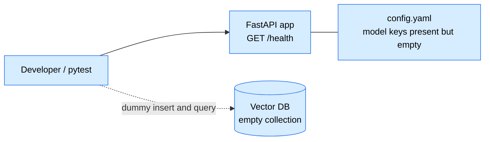

**Components**
- FastAPI app with `GET /health` → `{"status":"ok"}`.
- Config loader reading `config.yaml`; model-related keys exist but are unused.
- Vector DB library installed; a dummy collection is created and queried with **manually supplied vectors**.
- `pytest` configured with an `llm` marker, which the default run excludes.

**Not yet present:** Ollama, any chat or embedding model, any detection logic.

**Design notes:** vector DBs that ship a default embedding function can silently download a model on first use; always pass vectors explicitly in this phase.

---

## Stage 1 — Deterministic Detection (Phase 1)

**Adds:** the first real capability — string in, fired patterns out. Pure Python, no server, no I/O.

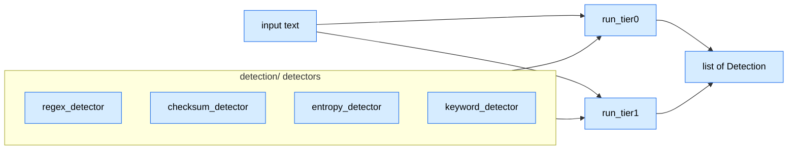

**Contract — `Detection`**

```python
@dataclass
class Detection:
    detector: str  # e.g. "luhn", "aws_key_regex"
    category: str  # e.g. "credit_card", "aadhaar", "secret"
    confidence: float  # 0.0–1.0
    span: tuple[int, int]
    tier: int  # 0 or 1
```

**Tier semantics:** the architectural contract is that **Tier 0 is high-certainty** (a hit short-circuits to Critical in Phase 6) and **Tier 1 is heuristic/ambiguous** (contributes to a weighted score and to the "should we call the LLM" decision). Exact detector-to-tier assignment follows the design doc.

**Design notes**
- `run_tier0` / `run_tier1` are pure, millisecond-fast, and independently callable.
- Checksums are not optional: a plain 12-digit regex flags phone and order numbers, so Aadhaar needs Verhoeff and cards need Luhn.
- Entropy thresholds are tuned on your own data.

---

## Stage 2 — Local LLM Text Classifier (Phase 2)

**Adds:** the first model dependency. Ollama + a chat model are installed here, not earlier.

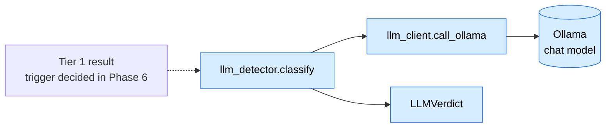

**Layering (important for Phase 5 reuse)**

| Module | Responsibility |
|---|---|
| `llm_client.py` | Prompt-agnostic: `call_ollama(prompt, schema, timeout) -> dict`, with timeout and one retry |
| `llm_detector.py` | Text-sensitivity prompt, builds on the client: `classify(text) -> LLMVerdict` |

**Contract — LLM response schema** (enforced via Ollama's `format` parameter)

```json
{"is_sensitive": true, "category": "string", "confidence": 0.0, "reason": "string"}
```

**Design notes**
- Temperature low or zero; input length capped.
- Timeout or failure returns "needs review."
- Prompts are narrow and example-anchored; small models are literal.
- Phase 5 imports `llm_client.py` directly, not `llm_detector.py`.

---

## Stage 3 — Confidential File Store & Vector Indexing (Phase 3)

**Adds:** the second pipeline's foundation. A designated folder is continuously mirrored, chunk by chunk, into the vector DB. The embedding model is installed here. Depends only on Phase 0 (plus the Ollama install shared with Phase 2), so it can be built in parallel with Phases 1–2.

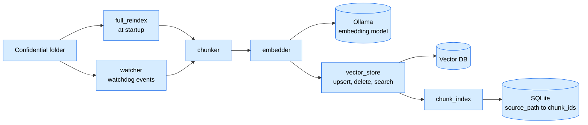

**Contract — `Chunk`**

```python
@dataclass
class Chunk:
    text: str
    source_path: str
    chunk_index: int
    # stored per chunk in the vector DB: content hash and enough original
    # text for Phase 5's LLM verification step
```

**Sync behaviour**

| Filesystem event | Action |
|---|---|
| Startup | Walk folder; skip unchanged files by hash; catch up on offline changes |
| Created | chunk → embed → upsert → record ids in SQLite |
| Modified | delete old chunks via mapping table, then re-index |
| Deleted / moved | remove chunks and mapping row |

**Design notes**
- The SQLite mapping table exists so deletes are exact and no orphaned vectors remain.
- Editor saves emit duplicate modify events; debounce them.
- Embed in batches for large files.
- The collection's vector dimension is tied to the embedding model; changing models means a full re-index.
- `chunker.py` and `embedder.py` are reused by Phase 4 on uploaded files.

---

## Stage 4 — Similarity Search on Upload (Phase 4)

**Adds:** the cheap half of the file funnel — an LLM-free (chat-model-free) decision on whether an uploaded file deserves escalation.

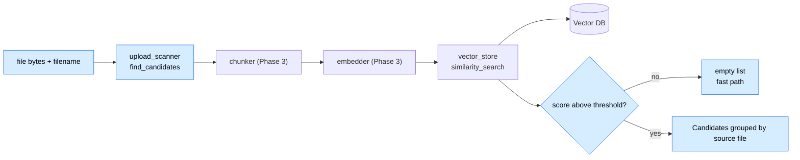

**Contract — `Candidate`**

```python
@dataclass
class Candidate:
    source_path: str
    top_score: float
    matched_chunk_ids: list[str]
    matched_chunk_texts: list[str]
```

**Design notes**
- Permissive threshold at first; tuned later with Phase 12 eval data.
- Decide per-chunk vs pooled-embedding search; cap file size and type so large files aren't chunked inline.
- An empty candidate list means no chat-model call at all.

---

## Stage 5 — Semantic Verification (Phase 5)

**Adds:** the expensive half of the file funnel. Candidates from Phase 4 are verified by the LLM, filtering out similar-but-not-confidential content (shared boilerplate, templates).

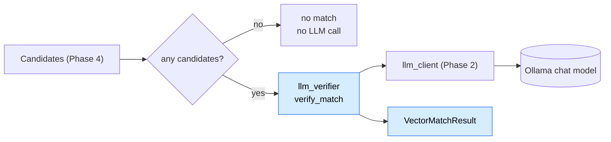

**Contracts**

```json
// LLM response schema for verification
{"is_match": true, "confidence": 0.0, "reason": "string"}
```

```python
@dataclass
class VectorMatchResult:
    matched: bool
    matched_source_path: str | None
    similarity_score: float
    llm_verdict: bool | None
    llm_reason: str | None
```

**Design notes**
- Verify the top candidate per matched source first; escalate only if ambiguous.
- `verify_match()` never runs with an empty candidate list.
- This phase must demonstrate at least one "similar but not confidential" rejection; that case is what justifies the phase's existence and the Phase 12 comparison.

---

## Stage 6 — Risk Fusion (Phase 6)

**Adds:** the merge point. Text signals and file-match signals become one `RiskResult`.

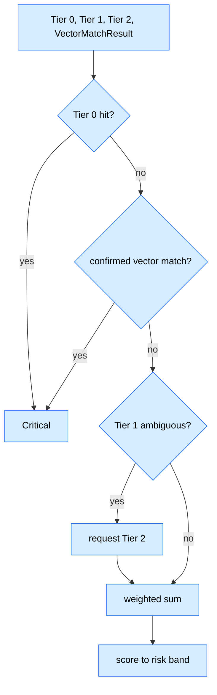

**Signature:** `fuse(tier0, tier1, tier2, vector_match=None) -> RiskResult` in `detection/fusion.py`.

**Rules**
1. A Tier 0 hit short-circuits to Critical.
2. An LLM-confirmed vector match short-circuits to Critical, carrying the matched file and reason for explainability.
3. Otherwise decide whether Tier 1 is ambiguous enough to warrant Tier 2.
4. Remaining cases use a weighted sum; weights and band thresholds are centralized in config.

**Design notes:** `fuse()` is deterministic. LLM confidence must never override what Tier 0/1 or a confirmed vector match already established.

---

## Stage 7 — Policy Engine & Enforcement (Phase 7)

**Adds:** turns a risk result into an action and carries it out.

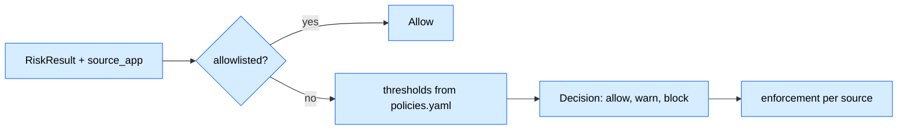

**Signature:** `decide(risk, source_app) -> Decision` in `policy/engine.py`.

**Policy config:** `policies.yaml` maps category → thresholds → enabled → exceptions, including a `confidential_file_match` category. The allowlist (app/domain, category, reason) is checked **before** thresholds.

**What "block" means per source**

| Source | Block behaviour |
|---|---|
| Clipboard | Cleared after the fact (cannot be prevented) |
| Browser upload / paste | Prevented before it lands (Phase 10) |
| Outbox upload channel | Per Phase 9 wiring; document the chosen behaviour |

---

## Stage 8 — Backend API & Audit Logging (Phase 8)

**Adds:** wraps Phases 1–7 into one running service with persistence. After this phase the backend is functionally complete; everything after it is input channels, UI, and evaluation.

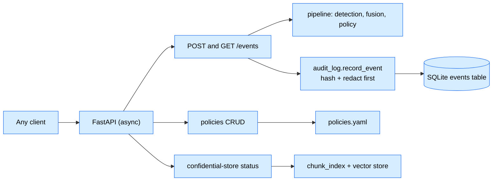

**Endpoints**

| Endpoint | Purpose |
|---|---|
| `POST /events` | Full pipeline for both text and file events; returns the decision |
| `GET /events` | Redacted event history |
| `/policies` (CRUD) | Read/update policy YAML |
| `/confidential-store` | Indexed files/chunks, last sync, pending operations |

**Events table** (extended for file matching): standard event fields plus `matched_source_path`, `similarity_score`, `llm_match_verdict`. It must never contain raw content; verify by inspecting the DB directly.

**Design notes:** async because LLM calls are I/O-bound; redaction (e.g. first/last two characters visible) happens before the write.

---

## Stage 9 — Clipboard Monitor & Upload Channel (Phase 9)

**Adds:** real input reaches the pipeline without manual API calls.

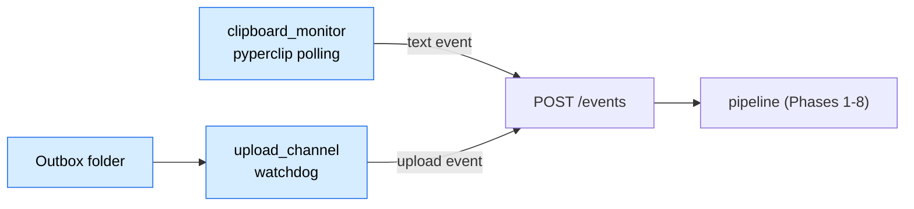

**Design notes**
- Clipboard: poll every few hundred ms, dedupe by last-seen hash, capture the foreground app.
- Upload channel is deliberately scoped to a controlled outbox folder or a demo app endpoint, **not** system-wide interception. This is a stated scoping decision for the paper.
- Both agents dedupe so resolved content isn't re-scanned after restart.

---

## Stage 10 — Browser Extension (Phase 10)

**Adds:** the most demoable edge: block a paste or attachment live in the browser.

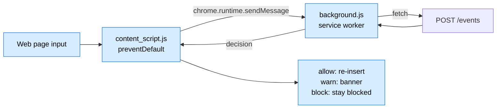

**Manifest V3 constraints**
- Content scripts cannot `fetch()` the backend directly; the content script → message → service worker → fetch → reply chain is mandatory.
- `host_permissions` must list the backend origin.
- Decisions are asynchronous (seconds when Tier 2 or Phase 5 fire), so the UX is decided up front: a visible "checking…" state or optimistic block-then-release.

For file matches, a block shows the matched file and the LLM's reasoning.

---

## Stage 11 — Dashboard (Phase 11)

**Adds:** a read-mostly local UI over the existing API. No new backend logic.

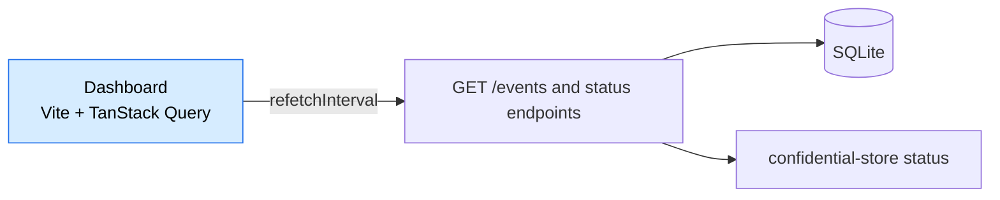

**Views:** status header (protection state, counts by risk band); event history (timestamp, source, category, risk band, action, redacted preview, LLM reason, matched filename and similarity score for file matches); confidential-store panel; read-only policy view.

**Design note:** runs entirely on localhost and shows only redacted data.

---

## Stage 12 — Evaluation Harness (Phase 12)

**Adds:** no runtime components; a measurement layer around the existing pipelines.

| Pipeline | Configurations compared |
|---|---|
| Text | Tier-1-only vs LLM-only vs full hybrid |
| File | Similarity-only (Phase 4) vs similarity + LLM verification (Phase 4 + 5) |

**Inputs:** `tests/eval/labeled_dataset.csv` and `tests/eval/labeled_file_pairs.csv`, both synthetic. The file-pairs set must include genuinely near-duplicate-but-not-confidential pairs, or Phase 5 can never show its value.

**Outputs:** precision, recall, F1 per category per configuration, false-positive rate, and latency per configuration. The Phase 4 threshold is re-tuned from this data.

---

## Stage 13 — Integration & Paper (Phase 13)

**Adds:** nothing new architecturally; verifies the assembled system from a clean state.

- Fresh venv, README-only setup, including Ollama install, model pulls, and re-indexing the confidential folder from scratch.
- Demo script covering one clipboard/text scenario and one file-upload-match scenario.
- Paper treats the vector pipeline as its own architectural contribution.

---

## The Complete System

### Runtime view

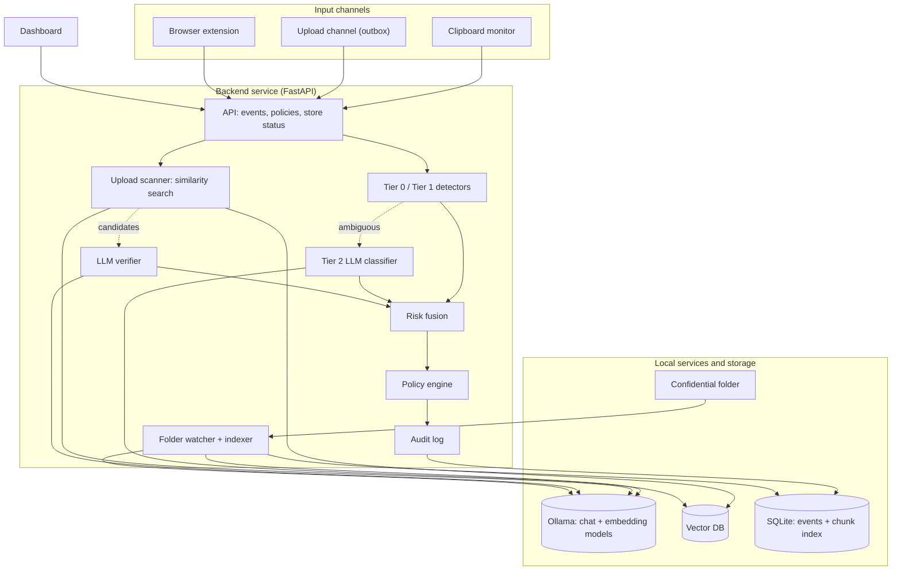

### Text event flow

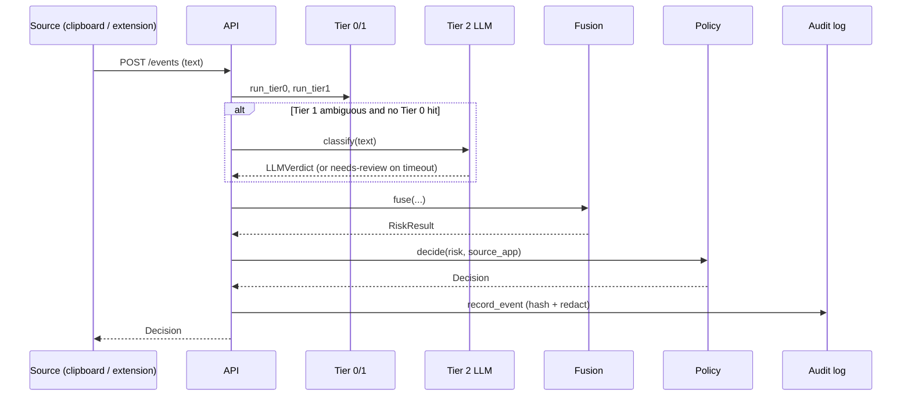

### File upload event flow

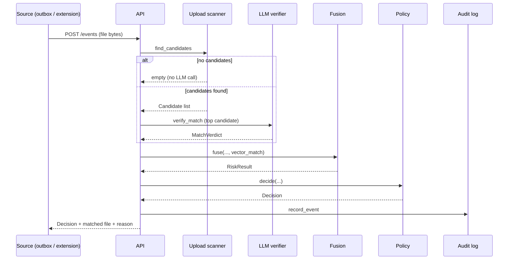

---

## Phase Dependencies

```
Phase 0 (skeleton)
   ├──────────────────────┐
   ▼                      ▼
Phase 1 (detectors)   Phase 3 (vector indexing)
   ▼                      ▼
Phase 2 (LLM classifier)  Phase 4 (similarity search)
   │      │                    │
   │      └──────────┬─────────┘
   │                 ▼
   │           Phase 5 (LLM verification)
   │                 │
   └────────┬────────┘
            ▼
     Phase 6 (risk fusion)
            ▼
     Phase 7 (policy + enforcement)
            ▼
     Phase 8 (API + audit log)
        │           │
        ▼           ▼
Phase 9 (clipboard + upload)   Phase 10 (browser extension)
        │           │
        └─────┬─────┘
              ▼
        Phase 11 (dashboard)
              ▼
        Phase 12 (evaluation)
              ▼
        Phase 13 (integration + paper)
```

---

## Shared Data Contracts (Summary)

| Contract | Defined in | Produced by | Consumed by |
|---|---|---|---|
| `Detection` | P1 | Tier 0/1 detectors | Fusion (P6) |
| `LLMVerdict` | P2 | `llm_detector` | Fusion (P6) |
| `Chunk` | P3 | `chunker` | `embedder`, `vector_store`, `upload_scanner` |
| `Candidate` | P4 | `upload_scanner` | `llm_verifier` (P5) |
| `MatchVerdict` | P5 | `llm_verifier` | `upload_scanner` (combined result) |
| `VectorMatchResult` | P5 | `upload_scanner` | Fusion (P6) |
| `RiskResult` | P6 | `fusion` | Policy (P7) |
| `Decision` | P7 | `policy.engine` | API (P8), edge enforcement (P9/P10) |
| Event row | P8 | `audit_log` | `GET /events`, dashboard (P11) |

---

## Open Architecture Decisions

Track these here as they get resolved; each one should end with a one-line rationale.

| Decision | Phase | Status |
|---|---|---|
| Vector DB choice (Chroma / FAISS / LanceDB) | 0 | ⬜ |
| Python version pin | 0 | ⬜ |
| Detector-to-tier assignment | 1 | ⬜ |
| Chat model (Qwen3-4B / Phi-4-mini / Llama-3.2-3B) | 2 | ⬜ |
| Embedding model | 3 | ⬜ |
| Per-chunk vs pooled-embedding search | 4 | ⬜ |
| Similarity threshold (initial) | 4 | ⬜ |
| Weighted-sum weights and band thresholds | 6 | ⬜ |
| Block semantics per source | 7 | ⬜ |
| Extension UX: "checking…" state vs optimistic block-then-release | 10 | ⬜ |
