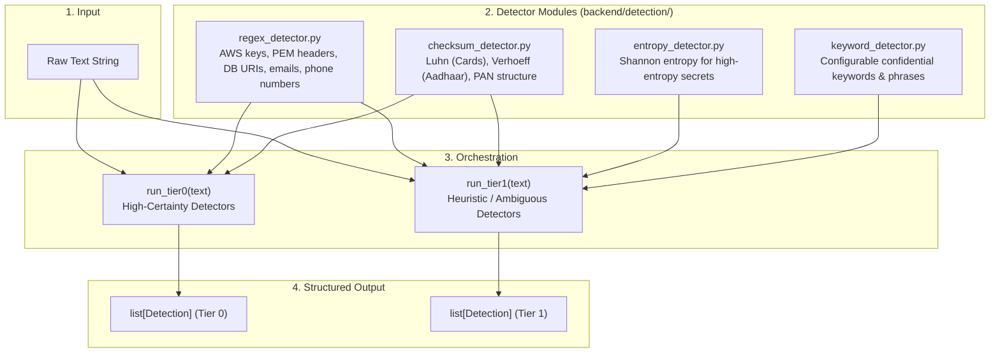

# Phase 1 Implementation Plan — Deterministic Detection Layer (Tier 0 & Tier 1)

Companion to `docs/local-shield-dlp-phases-final.md` and `docs/local-shield-dlp-architecture.md`.

---

## 1. Objective & Core Principle

**Goal:** Build a pure-Python, zero-I/O, high-throughput detection layer that accepts an arbitrary input string and returns structured `Detection` objects in milliseconds.

**Core Principles:**
- **Zero I/O & Millisecond-Fast:** No network calls, disk writes, or database queries. Pure in-memory pattern matching and checksum evaluation.
- **Portability:** No LLM or embedding model dependencies. Runs cleanly in standard Python environments.
- **Strict Tier Isolation:**
  - **Tier 0 (High Certainty):** Zero/near-zero false-positive indicators (e.g. valid Luhn credit cards, verified Verhoeff Aadhaar numbers, valid PANs, AWS access keys, PEM private keys, database connection URIs). In Phase 6, any Tier 0 hit immediately short-circuits to `Critical`.
  - **Tier 1 (Heuristic / Ambiguous):** Context-dependent indicators (e.g. Shannon entropy spikes, email addresses, phone numbers, confidential keyword markers). These contribute to a weighted risk score and determine whether Tier 2 LLM verification is warranted.

---

## 2. Architecture & Data Flow



---

## 3. Data Model Specification

File: `backend/detection/types.py`

```python
from dataclasses import dataclass
from typing import Tuple, Optional


@dataclass(frozen=True)
class Detection:
    detector: str  # e.g., "luhn", "verhoeff_aadhaar", "pan", "aws_key_regex", "pem_key", "shannon_entropy", "keyword"
    category: str  # e.g., "credit_card", "aadhaar", "pan", "aws_key", "pem_key", "db_uri", "email", "phone_number", "high_entropy_secret", "confidential_keyword"
    confidence: float  # 0.0 to 1.0
    span: Tuple[int, int]  # (start_index, end_index) in input text
    tier: int  # 0 (Tier 0: High Certainty) or 1 (Tier 1: Heuristic)
    matched_text: Optional[str] = (
        None  # Captured snippet (used for internal validation / redaction)
    )
```

---

## 4. Module Breakdown & Algorithms

### 4.1 Checksum Detector (`backend/detection/checksum_detector.py`)
- **Luhn Algorithm (`validate_luhn(card_number: str) -> bool`):**
  - Extracts 13–19 digit candidate sequences (stripping spaces and hyphens).
  - Evaluates standard ISO/IEC 7812 Luhn formula: double every second digit from right to left, subtract 9 if > 9, sum digits, check if `sum % 10 == 0`.
  - **Tier Assignment:** Tier 0 (Confidence: `0.95`).
- **Verhoeff Algorithm (`validate_verhoeff_aadhaar(aadhaar_str: str) -> bool`):**
  - Validates 12-digit Indian Aadhaar sequences using multiplication ($d$) and permutation ($p$) matrices + inverse table ($inv$).
  - Prevents single-digit transcription errors and adjacent transpositions.
  - Ensures ordinary 12-digit timestamps, order IDs, and phone numbers are not falsely flagged.
  - **Tier Assignment:** Tier 0 (Confidence: `0.95`).
- **Permanent Account Number (`validate_pan(pan_str: str) -> bool`):**
  - Evaluates Indian Income Tax PAN structure: `[A-Z]{3}[PCHFATBLJG][A-Z][0-9]{4}[A-Z]`.
  - 4th character must match valid entity status types (e.g., `P` for Individual, `C` for Company, `H` for HUF, `F` for Firm, etc.).
  - **Tier Assignment:** Tier 0 (Confidence: `0.90`).

---

### 4.2 Regex Detector (`backend/detection/regex_detector.py`)
Pre-compiled regex patterns with word boundary constraints:

- **Tier 0 Patterns (High Certainty):**
  - `PEM_KEY`: `-----BEGIN (?:RSA |EC |DSA |OPENSSH )?PRIVATE KEY-----`
  - `AWS_ACCESS_KEY`: `\b(?:AKIA|ABIA|ACCA|ASIA)[0-9A-Z]{16}\b`
  - `AWS_SECRET_KEY`: `(?i)\b(?:aws_secret_access_key|aws_secret_key|secret_key)\s*[:=]\s*['"]?([A-Za-z0-9/+=]{40})['"]?\b`
  - `DB_CONNECTION_STRING`: `\b(?:postgres(?:ql)?|mysql|mongodb(?:\+srv)?|redis|mssql):\/\/[^\s:@]+:[^\s:@]+@[^\s:@\/]+(?::\d+)?\/[^\s?#]*\b`
- **Tier 1 Patterns (Heuristic / Ambiguous):**
  - `EMAIL_ADDRESS`: RFC 5322 compliant regex (`\b[A-Za-z0-9._%+-]+@[A-Za-z0-9.-]+\.[A-Z|a-z]{2,}\b`)
  - `PHONE_NUMBER`: E.164 and international/domestic formats (e.g., `(?:\+?91[\-\s]?)?[6789]\d{9}`, `\+?1[\-\s]?\(?\d{3}\)?[\-\s]?\d{3}[\-\s]?\d{4}`)

---

### 4.3 Entropy Detector (`backend/detection/entropy_detector.py`)
- **Shannon Entropy Calculation:**
  $$H(X) = -\sum_{i=1}^{n} P(x_i) \log_2 P(x_i)$$
- **Logic:**
  - Tokenizes input text into candidate alphanumeric blocks (min length $\ge 16$, ignoring standard URLs, dictionary words, and common programming tokens).
  - Calculates entropy score. High random tokens (Base64, Hex, high-entropy API secrets) exceeding threshold (e.g. $H \ge 4.5$ for Base64 or $H \ge 3.2$ for Hex strings $\ge 20$ chars) are flagged.
  - **Tier Assignment:** Tier 1 (Confidence: scaled between `0.60` and `0.85`).

---

### 4.4 Keyword Detector (`backend/detection/keyword_detector.py`)
- Scans for configurable sensitivity markers and legal notices:
  - `"strictly confidential"`, `"confidential & proprietary"`, `"internal use only"`, `"do not distribute"`, `"trade secret"`, `"company confidential"`, `"restricted access"`.
- Performs case-insensitive, word-boundary, and punctuation-normalized scanning.
- **Tier Assignment:** Tier 1 (Confidence: scaled by specificity from `0.60` to `0.80`).

---

### 4.5 Tier Runners (`backend/detection/runner.py` & `backend/detection/__init__.py`)
- **`run_tier0(text: str) -> list[Detection]`:**
  - Executes: Validated Luhn cards, validated Verhoeff Aadhaar, valid PANs, PEM private keys, AWS access keys, DB connection strings with credentials.
  - Fast short-circuiting capability.
- **`run_tier1(text: str) -> list[Detection]`:**
  - Executes: Shannon entropy scanner, email detector, phone number detector, confidential keyword scanner.
  - Returns heuristic matches to feed into score fusion.

---

## 5. Test Suite Plan

| Test File | Test Cases |
| :--- | :--- |
| `tests/unit/test_checksum_detector.py` | - Valid Visa/Mastercard/Amex/Discover numbers (Hit)<br/>- Random 16-digit number failing Luhn (Clean Miss)<br/>- Valid 12-digit Aadhaar matching Verhoeff (Hit)<br/>- Invalid 12-digit Aadhaar / 12-digit order ID / timestamp (Clean Miss)<br/>- Valid Individual/Company PAN (Hit)<br/>- Malformed 10-char string / bad 4th character PAN (Clean Miss) |
| `tests/unit/test_regex_detector.py` | - RSA / OpenSSH PEM private key headers (Hit) vs regular text (Miss)<br/>- AKIA AWS Access Keys (Hit) vs random 20-char word (Miss)<br/>- Postgres/Mongo connection strings with password (Hit) vs plain URI without creds (Miss)<br/>- Standard and international email formats (Hit) vs invalid emails (Miss)<br/>- Indian & US format phone numbers (Hit) vs integers/dates (Miss) |
| `tests/unit/test_entropy_detector.py` | - High-entropy Base64/Hex API tokens (Hit)<br/>- Standard English sentences and normal code/variable names (Miss)<br/>- Repetitive strings (e.g., `AAAAAAAAAAAAAAAAAAAA`) (Miss) |
| `tests/unit/test_keyword_detector.py` | - Exact and punctuation-variant matches for "Strictly Confidential" (Hit)<br/>- "Internal Use Only" with extra whitespace/newlines (Hit)<br/>- Ordinary words containing substrings (e.g. "confidence") (Clean Miss) |
| `tests/unit/test_tier_runners.py` | - Ensure `run_tier0` only emits `tier == 0` detections<br/>- Ensure `run_tier1` only emits `tier == 1` detections<br/>- Execution time benchmarking ($< 5\text{ ms}$ for standard payloads) |

---

## 6. Exit Criteria Checklist

- [ ] All detector modules implemented (`types.py`, `checksum_detector.py`, `regex_detector.py`, `entropy_detector.py`, `keyword_detector.py`, `runner.py`).
- [ ] Every detector tested with both true positives (hits) and true negatives (clean misses).
- [ ] Tier 0 and Tier 1 results are cleanly separated and verified.
- [ ] Functions are 100% pure and execute in under 5ms.
- [ ] `pytest` passes 100% cleanly without requiring any LLM/Ollama setup.
